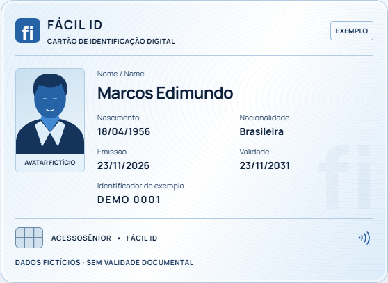

# Cartão final da demonstração

O último passo agora apresenta um cartão Fácil ID inspirado na hierarquia visual do CIE: avatar à esquerda, identificação à direita, textura de linhas, chip e marca em azul. Todos os exemplos públicos usam Marcos Edimundo. Datas e identificador são fictícios; o cartão indica que não tem validade documental. Não contém brasões oficiais, credenciais reais ou leitura NFC funcional.

A máquina de estados e o PIN de exemplo 1234 permanecem iguais. CSS isolado preserva o cartão animado da abertura. A entrada do novo cartão respeita movimento reduzido.

20 verificações Playwright aprovadas, incluindo seis viewports da página, cartão em 1440/390/375/320px, erro/recuperação/sucesso/reinício, teclado, menu, reflow, movimento reduzido, console e rede. Capturas reais revisadas. Nenhuma alteração de dependências, backend ou Expo; o site continua estático.

Relatório local: `reports/website-identity-final.json`. Conclusão: 2026-11-24T01:01:52.041Z. SHA-256: `9306ae5655e2541d17994c04e20b3998345ee192a8ef214f58bfa2cc2c23c1ae`.

| Computador | Celular |
| --- | --- |
|  |  |

Publicação autorizada no endereço https://facilid.pages.dev/. O resultado público será confirmado após o deploy.
