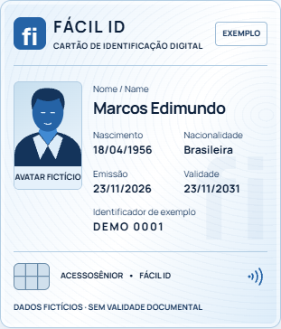
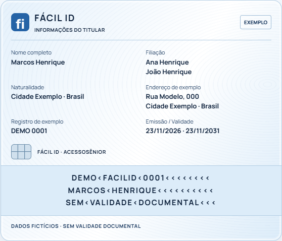
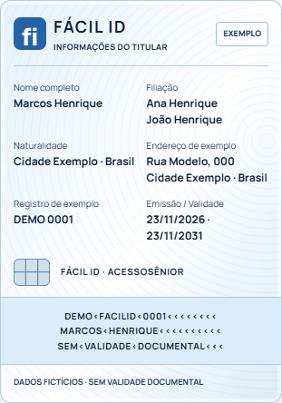

# Cartão final da demonstração

O último passo agora apresenta um cartão Fácil ID inspirado na hierarquia visual do CIE: avatar à esquerda, identificação à direita, textura de linhas, chip e marca em azul. Todos os exemplos públicos usam Marcos Henrique. As capturas abaixo registram a versão anterior à troca de nome. Datas e identificador são fictícios; o cartão indica que não tem validade documental. Não contém brasões oficiais, credenciais reais ou leitura NFC funcional.

A máquina de estados e o PIN de exemplo 1234 permanecem iguais. CSS isolado preserva o cartão animado da abertura. A entrada do novo cartão respeita movimento reduzido.

20 verificações Playwright aprovadas, incluindo seis viewports da página, cartão em 1440/390/375/320px, erro/recuperação/sucesso/reinício, teclado, menu, reflow, movimento reduzido, console e rede. Capturas reais revisadas. Nenhuma alteração de dependências, backend ou Expo; o site continua estático.

Relatório local: `reports/website-identity-final.json`. Conclusão: 2026-11-24T01:01:52.041Z. SHA-256: `9306ae5655e2541d17994c04e20b3998345ee192a8ef214f58bfa2cc2c23c1ae`.

| Computador | Celular |
| --- | --- |
|  |  |

Publicado em https://facilid.pages.dev/ pelo PR #5, commit `cc6f15e`. Cloudflare confirmou sucesso. Três verificações adicionais de produção passaram em 2026-11-24T01:04:09.588Z: fluxo completo com cartão nas quatro larguras, ausência de chamadas de API e console/HTTP. Relatório: `reports/website-identity-production.json`. Revisão de código e capturas realizada nesta tarefa; CodeRabbit foi cancelado após o merge e não é apresentado como aprovação.

## Verso e botão de virar

Frente e verso preservam o espaço do cartão. Só a face visível fica disponível para leitores de tela; a outra usa `inert`, `aria-hidden` e visibilidade CSS. O botão mantém foco e anuncia o lado. Entrada com rotação leve, desativada com movimento reduzido. Reiniciar restaura a frente. Dados e faixa de caracteres são fictícios.

6 verificações aprovadas em 2026-11-24T01:11:08.877Z: fluxo completo, frente/verso em 1440/390/375/320px, Enter/Espaço, cliques repetidos, foco, reinício, axe no verso mobile, reflow, movimento reduzido e console/HTTP. Relatório local: `reports/website-card-back.json`. Capturas reais revisadas.

| Verso no computador | Verso no celular |
| --- | --- |
|  |  |

Verso publicado em https://facilid.pages.dev/ pelo PR #7, commit `5379165`. Cloudflare confirmou sucesso. Duas verificações de produção aprovadas em 2026-11-24T01:12:39.520Z: fluxo completo de frente/verso nas quatro larguras, teclado, reinício e console/HTTP (`reports/website-card-back-production.json`).
