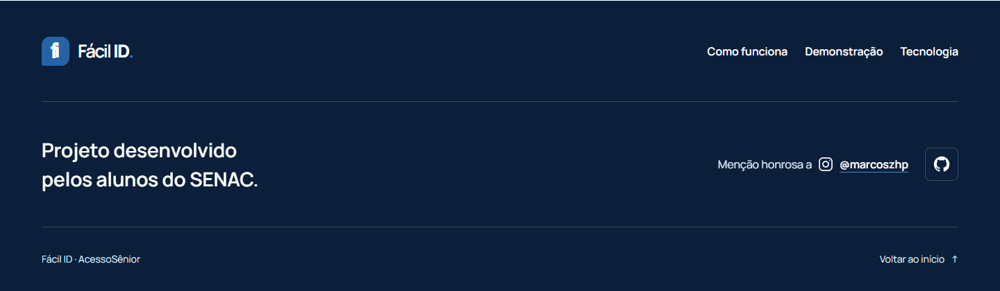
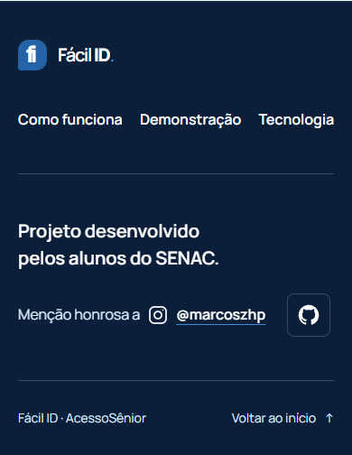

# Revisão editorial e créditos — Fácil ID

23 de novembro de 2026. Escopo: o site existente em `website/`, sem migração de arquitetura, novas dependências ou alterações no aplicativo, API e máquina de estados da demonstração.

## Alterações

- Removidos os dez textos solicitados, suas repetições, legendas decorativas, subtítulos redundantes e seletores correspondentes.
- Mantidos o propósito social, as fotografias reais, os mockups, o fluxo NFC com confirmação adicional e os recursos de acessibilidade.
- A simulação continua identificada como **Modo demonstração**, com um aviso único: “Simulação com dados fictícios, sem leitura NFC, login ou envio de dados.” O PIN de exemplo e a orientação para não usar um PIN pessoal permanecem visíveis.
- Ajustados os espaços da abertura, das seções e da demonstração. As animações existentes foram preservadas; referências a elementos removidos foram retiradas.
- Rodapé azul-marinho com **Projeto desenvolvido pelos alunos do SENAC.** e **Menção honrosa a @marcoszhp**. Instagram e GitHub têm ícones SVG, foco visível, alvos de 48px, abertura em nova aba e `rel="noopener noreferrer"`.
- Animação discreta dos créditos ao entrar na tela, desativada com movimento reduzido. Conteúdo e links continuam visíveis sem JavaScript.

## Validação executada

Comando: `node scripts/test-website.mjs --label=editorial-final`.

**20 verificações aprovadas**, concluídas em **23/11/2026 às 19:47:49 em Brasília (22:47:49 UTC)**. Relatório local: `reports/website-editorial-final.json`. Ambiente: Windows, Node 26.13.0, Chrome 157.0.8103.80, Playwright 1.65.1 e axe 4.14.0.

SHA-256 do conjunto público testado: `a884c562c8bcf6caa5d5ed2e38eae429c685b99cfe24313e20ebb7be83400f8a`.

| Verificação | Resultado |
| --- | --- |
| 1920×1080, 1440×900, 1366×768, 768×1024, 390×844 e 375×812 | Sem transbordamento horizontal |
| Textos removidos e duplicações | Busca no código público e texto renderizado sem ocorrências proibidas; um aviso funcional |
| Créditos e links | Texto correto; ambos os perfis abriram pela tecla Enter em novas abas, com `window.opener === null` |
| Hero, menu e navegação | Quatro etapas, replay, âncoras, toque, teclado, Escape e foco aprovados |
| Demonstração | Cartão válido/inválido, PIN incorreto, recuperação, sucesso, cancelamento e reinício aprovados |
| Adaptação | Reflow equivalente a 200%/400%, movimento reduzido e uso sem JavaScript aprovados |
| Acessibilidade automática | Zero violações axe nos oito estados auditados, incluindo créditos desktop/mobile |
| Console e rede | Sem erros; demonstração sem chamadas de API ou transmissão de dados |
| Build de produção | `npm run build` concluído: TypeScript do backend e exportação web do Expo aprovados |
| Integridade do patch | `git diff --check` aprovado |

O site institucional é estático: Cloudflare publica diretamente `website/`. O build acima verifica os workspaces existentes, não transforma a landing page em React.

O axe marcou contraste de alguns elementos compostos como inconclusivo; as verificações de contraste em superfícies sólidas passaram. Capturas reais foram revisadas em desktop e celular. Isso não constitui certificação WCAG nem substitui ensaios com leitores de tela e pessoas idosas. Não foram produzidas notas de Lighthouse ou métricas de usuários reais nesta revisão.

## Evidências visuais

Capturas completas e estados interativos: `output/playwright/facilid-2/editorial-final/`. O registro anterior veio do site publicado, antes das alterações, em `output/playwright/facilid-2/editorial-antes/`.

| Antes da limpeza | Após a limpeza |
| --- | --- |
|  |  |

| Créditos no computador | Créditos no celular |
| --- | --- |
|  |  |

## Publicação

**Publicado em https://facilid.pages.dev/** pelo [PR #4](https://github.com/marcoszhp/facilId/pull/4), integrado em `main` no commit `59ddeaf62efcaccdfc578a121178312b82f3f3ff`. Cloudflare confirmou a implantação `b6cd340a-3e39-4538-a1d2-5f46294d9552`. A revisão automática CodeRabbit terminou com sucesso, sem comentários de revisão.

A [prévia fixa](https://62c49b47.facilid.pages.dev/) passou em três verificações adicionais, e seus dez arquivos públicos corresponderam aos arquivos do commit Git (sem a conversão de quebras de linha do checkout Windows). Em produção, **sete verificações passaram às 19:55:32 de Brasília (22:55:32 UTC)**: desktop/mobile, limpeza editorial, créditos e links, demonstração completa, rede e console. Relatórios locais: `reports/website-editorial-preview.json`, `reports/website-editorial-preview-assets.json` e `reports/website-editorial-production.json`.

## Referências consultadas

- [MDN — elemento de link](https://developer.mozilla.org/en-US/docs/Web/HTML/Reference/Elements/a): navegação e proteção da nova aba.
- [Web Interface Guidelines](https://github.com/vercel-labs/web-interface-guidelines/blob/main/command.md): revisão de foco, texto, semântica e movimento reduzido.
