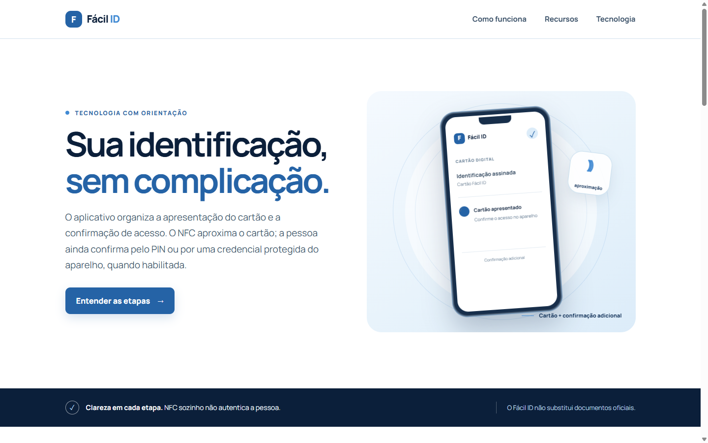

# Validação do site Fácil ID 2.0

Execução final da reconstrução em **23/11/2026, às 14:34:27 UTC (11:34:27 em Brasília)**. Escopo: `website/`, apresentação institucional estática e demonstração local. **18 cenários aprovados**, sem alteração dos arquivos durante a execução. A versão foi posteriormente publicada em https://facilid.pages.dev/ pelo PR #3, commit `9ada16e`, com autorização do usuário; cinco verificações adicionais em produção passaram (`reports/website-production.json`). Os registros de prévia abaixo descrevem a etapa anterior à publicação. A revisão seguinte tem um relatório próprio: [Validação editorial](VALIDACAO-EDITORIAL.md).

Relatório local: `reports/website-depois.json`. Hash SHA-256 do conjunto público, calculado pelo roteiro de teste: `b2e5ac1df71f133e21c3bb9c22c2bc2ed49ebd23d3c4984afea1fd7d537157c1`.

## Ambiente e reprodução

Windows, Node.js 26.13.0, Chrome 157.0.8103.80, Playwright 1.65.1 e `@axe-core/playwright` 4.14.0. As ferramentas de teste ficam em `reports/website-tools`, ignorado pelo Git; não são dependências do site nem alteram os workspaces backend/mobile.

```powershell
npm install --prefix reports/website-tools --no-save --package-lock=false playwright@1.65.1 @axe-core/playwright@4.14.0
node scripts/test-website.mjs
```

O comando inicia um servidor HTTP temporário de `website/`, abre Chrome, executa os cenários, salva `reports/website-depois.json` e capturas em `output/playwright/facilid-2/depois/`, fecha o navegador e encerra o servidor. Requer Chrome instalado. `--headed` mostra o navegador; `--url=URL` permite testar uma prévia já servida. A opção `--baseline --url=https://facilid.pages.dev/ --label=antes-audit` captura uma versão anterior sem exigir que ela já tenha a demonstração nova. Não use essa URL como baseline depois que a versão nova for publicada.

## Registro anterior

A versão pública foi capturada antes da alteração, em Chrome real, nas dimensões 1920×1080, 1440×900, 1366×768, 768×1024, 390×844 e 375×812, com capturas da primeira tela e da página inteira. Nenhuma apresentou rolagem horizontal. Não foram encontrados erros de console, falhas de solicitação ou respostas HTTP de erro.

O axe encontrou duas regras com violações na versão anterior: `color-contrast` (8 elementos em 1440px e 7 em 390px) e `label-content-name-mismatch` no logotipo (1 elemento em cada dimensão). O resultado completo, incluindo casos que exigem revisão humana, está no relatório local `reports/website-antes-audit.json`.

| Antes, desktop 1440×900 | Antes, mobile 390×844 |
| --- | --- |
|  |  |

## Resultado e comparação visual

| Depois, desktop 1440×900 | Depois, mobile 390×844 |
| --- | --- |
|  |  |

Páginas completas: [desktop](evidencias/site-2/depois-desktop-completo.png) e [celular](evidencias/site-2/depois-mobile-completo.png). As capturas originais dos seis tamanhos, estados da demonstração e quatro etapas da hero ficam em `output/playwright/facilid-2/depois/`. São capturas do Chrome renderizando a aplicação, sem montagem ou geração sintética.

| Aspecto | Antes | Depois observado |
| --- | --- | --- |
| Hero e impacto visual | Celular isolado em um painel arredondado | Celular e cartão em perspectiva, quatro estados coordenados e opção de rever |
| Hierarquia e espaço | Conteúdo mais estreito e explicação longa na abertura | Container de 1320px, título amplo, explicação curta e ação direta |
| Composição e originalidade | Predomínio de blocos de texto e cartões | Sequência ilustrada, fotografia editorial ampla, demonstração escura, recursos assimétricos e diagrama |
| Consistência | Identidade azul, com elementos menores | Manrope local, tokens de cor/espaçamento, controles uniformes e cabeçalho integrado |
| Presença humana | Sem fotografia na página publicada | Duas fotos reais e licenciadas de idosos negros utilizando tecnologia |
| Funcionalidade | Ação principal levava a uma explicação | Ação principal leva à experiência interativa com PIN, erro, recuperação e reinício |
| Acessibilidade | Duas regras axe com violações | Nenhuma violação automática nos seis estados auditados; teclado, reflow e movimento reduzido verificados, com limites abaixo |

A revisão visual de Astra conferiu a aplicação renderizada e as capturas desktop/mobile. Foram corrigidos o corte lateral do título mobile, o espaço entre chip e nome no cartão, textos pequenos, a perda de foco durante processamento e a ação duplicada de reinício no sucesso. O [estado final da demonstração](evidencias/site-2/demo-sucesso.png) oferece uma única ação para começar novamente. O reteste completo acima foi executado após essas correções. Esta comparação descreve alterações observáveis; não atribui notas subjetivas de qualidade.

## Cenários aprovados

- Seis dimensões: 1920×1080, 1440×900, 1366×768, 768×1024, 390×844 e 375×812; sem rolagem horizontal ou texto relevante ultrapassando a largura disponível.
- Hero: quatro estados, término da sequência e versão sem movimento.
- Teclado: pular conteúdo, navegar até a demonstração, preencher/apagar/limpar PIN, confirmar e manter foco útil.
- Menu mobile: toque, teclado, Escape, destino das âncoras e mudança de largura.
- Links internos, ampliação do exemplo de texto e repetição da animação.
- Conteúdo e navegação utilizáveis com JavaScript desabilitado.
- Demonstração: cartão apresentado, processamento, PIN incorreto, recuperação, sucesso e reinício.
- Cartão inválido, cancelamento de etapas pendentes e reinício sem persistência.
- Reflow em 640px e 320px CSS e demonstração com movimento reduzido.
- Demonstração sem chamadas de API, envio de dados ou acesso a outros domínios.
- Nenhum erro de console, solicitação falha ou resposta HTTP de erro na execução local.

O axe verificou desktop, mobile, menu aberto, PIN incorreto, sucesso e cartão inválido mobile. Nenhum desses estados teve violações automáticas. A ferramenta deixou **69 a 83 elementos por estado** com contraste inconclusivo, principalmente por fundos compostos/pseudo-elementos. O roteiro também calcula contraste de oito textos principais sobre fundos sólidos, todos pelo menos 4,5:1. Isso não comprova o contraste de todos os pixels, imagens ou gradientes; a revisão humana e testes com leitores de tela continuam necessários.

## Desempenho observado

Medição local, sem redução artificial de velocidade. LCP abaixo é o valor observado **antes da rolagem automática para as capturas**, após a sequência da hero; a captura completa carrega imagens adicionais e não serve como medida de LCP inicial.

| Tela | LCP observado | CLS inicial | Arquivos carregados após percorrer a página, sem compressão HTTP |
| --- | --- | --- | --- |
| 1920×1080 | 1656 ms | 0,000192 | 232.408 bytes |
| 1440×900 | 1608 ms | 0,000407 | 232.408 bytes |
| 1366×768 | 1600 ms | 0,000014 | 232.408 bytes |
| 768×1024 | 1596 ms | 0,000021 | 232.408 bytes |
| 390×844 | 1600 ms | 0,000016 | 209.454 bytes |
| 375×812 | 1604 ms | 0 | 209.454 bytes |

Durante o cenário completo da demonstração, CLS observado de 0,02523. Event Timing registrou eventos de interação de 16ms; esse registro não é uma medição de INP de campo. Os dois módulos JavaScript somam 14.265 bytes; a fonte local, 24.532 bytes. As fotografias carregam sob demanda e a principal usa versões responsivas. Nenhuma biblioteca de animação ou runtime de framework foi adicionada ao site.

## Método e limites

### Conferência da prévia publicada

O [PR #3](https://github.com/marcoszhp/facilId/pull/3) publicou automaticamente a [prévia Cloudflare](https://feat-facilid-2-premium.facilid.pages.dev/). O [deploy fixo `b9e2c30f`](https://b9e2c30f.facilid.pages.dev/) corresponde ao código `3886dfa`. Cinco verificações adicionais no endereço HTTPS passaram às **14:35:52 UTC em 23/11/2026**: desktop 1440×900, mobile 390×844, demonstração com PIN incorreto/recuperação/sucesso/reinício, ausência de transmissão e ausência de erros de console/HTTP. Relatório local: `reports/website-preview.json`; capturas em `output/playwright/facilid-2/preview/`.

Os dez arquivos públicos conferidos responderam HTTP 200 e correspondem aos arquivos locais (comparação de bytes para imagens/fonte e normalização apenas de finais de linha para textos). O módulo `.mjs` foi servido como JavaScript; fonte e imagens tiveram tipos corretos. Registro: `reports/website-preview-assets.json`. A produção continuou com o conteúdo anterior e `main` em `48e9bbe`; nenhum merge foi realizado.

Regressão dos workspaces executada por `npm run check`, concluída às 21:46:11 UTC em 22/11/2026: tipos e builds aprovados, 191 testes backend e 160 mobile aprovados (351 ao todo), com `changedDuringRun: false`. O aviso preexistente de depreciação de `SafeAreaView` continua. Não houve execução de testes MySQL reais nem acesso a dados externos. Evidência local: `reports/website-regression-check.json` e logs de types/tests/build.

As capturas usam [Playwright](https://playwright.dev/docs/screenshots). O axe cobre regras automatizáveis WCAG 2 A/AA, 2.1 A/AA e 2.2 AA; um resultado sem violações não equivale a uma certificação de acessibilidade. Permanecem necessárias avaliações humanas e com usuários de tecnologias assistivas, como explica a [documentação oficial](https://playwright.dev/docs/accessibility-testing).

O reflow foi verificado em 640px e 320px CSS, equivalentes a 200% e 400% de zoom numa janela de 1280px. Essa é uma verificação de área útil equivalente; não simula o gesto nem o menu de zoom nativo do navegador. A equivalência de 320px a 400% é descrita no [critério de reflow do W3C](https://www.w3.org/WAI/WCAG22/Understanding/reflow.html).

LCP e CLS são observações de laboratório coletadas por `PerformanceObserver` em contextos novos, sem limitação artificial de rede/CPU. CLS usa a maior janela de deslocamentos, com intervalos inferiores a 1s e duração de até 5s, seguindo a [definição oficial](https://web.dev/articles/cls). Os valores não são percentis de usuários reais. Tempos do site remoto comprimido e do servidor local sem compressão não permitem atribuir ganho de velocidade à alteração.

Event Timing registra apenas eventos realmente produzidos pelos cliques/toques/teclado dos testes. Ausência de entradas acima de 16ms não significa latência zero. Esses registros não são apresentados como INP de campo; o [INP](https://web.dev/articles/inp) depende das interações ao longo de uma visita. Não foi executado Lighthouse e nenhuma nota foi atribuída.

Não foram realizados testes com leitores de tela reais, sessões com pessoas idosas, aparelhos físicos ou outros motores de navegador. Essas verificações e a aprovação visual do usuário permanecem como limites da entrega, sem bloqueios conhecidos nos cenários efetivamente executados.
